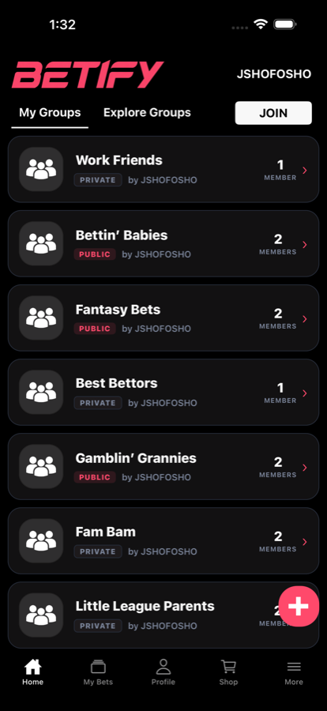
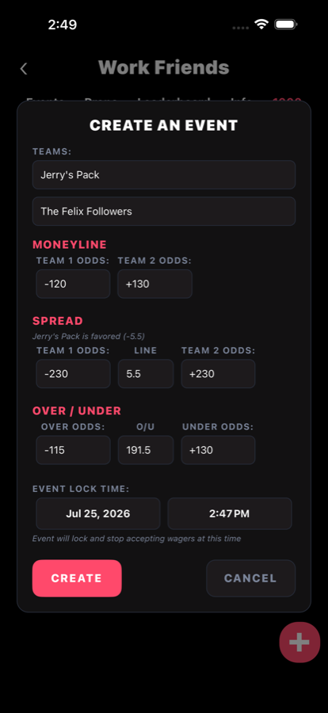
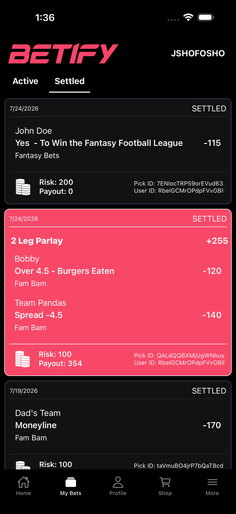
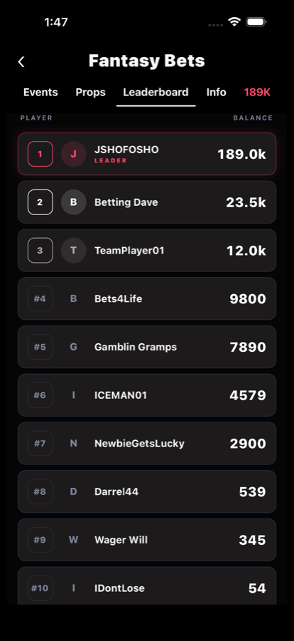
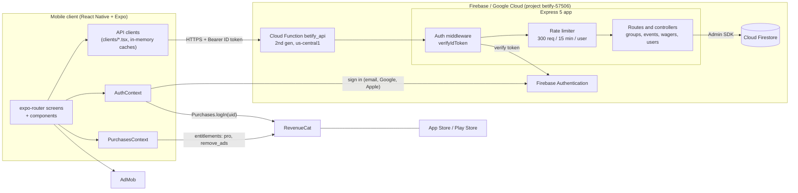
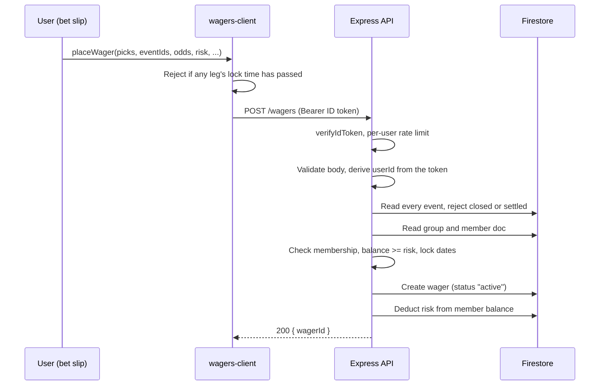
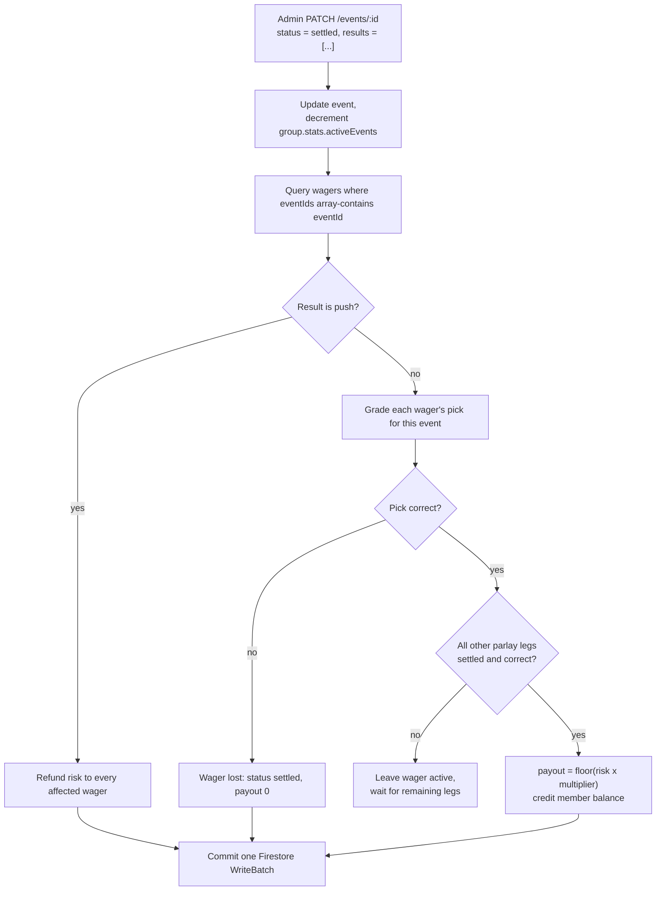

# Betify

**A social prediction app for the bets sportsbooks will never offer.**
 Who eats the most burgers? Who wins the office fantasy league? Betify lets a group of friends create their own events, set their own odds, and compete with virtual currency that has no cash value.


<p align="center">
  
  
  
  
</p>

Betify is a solo-built, full-stack, cross-platform mobile product: a React Native & TypeScript client and a serverless Node.js API, backed by Firebase. It covers authentication, a betting engine with American-odds and parlay math, event settlement, subscriptions, and ads.

> The app is a game of virtual currency only. Nothing in it has monetary value or can be cashed out.

---

## Engineering highlights

**1. A betting engine with real sportsbook semantics.**
Events come in three kinds (see [Event types](#event-types)): moneyline/spread/over-under, player props, and single-outcome yes/no events. Users build parlays of any number of legs across events. Payouts use standard American-odds math: each leg converts to a decimal multiplier, the legs multiply, and the result converts back for display ([`utils/odds.ts`](utils/odds.ts)). Settlement handles wins, losses, pushes (full refund), and parlays whose other legs have not resolved yet.

**2. Event settlement that fans out to every affected wager.**
When an admin settles an event, the API queries every wager containing that event, grades each pick, and writes every wager status change and balance credit in a single Firestore `WriteBatch`. A parlay only pays when every leg's event is settled and correct. See [Event settlement](#2-event-settlement).

**3. Per-group economies.**
Each group is its own economy. Balances live in a `groups/{id}/members/{uid}` subcollection, so the same user can hold 50,000 coins in one group and 200 in another..

**4. Race-safe group creation and invite codes.**
Group creation runs inside a Firestore **transaction** that picks a random 6-character invite code from an alphabet with look-alike characters removed (no `0/O`, `1/I`), checks it against an `inviteCodes` collection, and writes the group, the code reservation, and the creator's member record atomically. Codes come from `crypto.randomInt`, not `Math.random`.

**5. Cursor-paginated, filter-aware feeds.**
Explore Groups and the per-group event and prop feeds use Firestore cursor pagination (`startAfter` on a document snapshot). Because "groups I'm not in" cannot be expressed as a Firestore query, the server over-fetches and filters in a loop until it has a full page, then returns the last *examined* document as the cursor, so the next page never skips or repeats items.

**6. Authentication that spans native SDKs, Firebase, and a third-party billing identity.**
Sign-in supports email/password, native Google Sign-In, and Sign in with Apple, all exchanged for Firebase credentials.

---

## Architecture



| Layer | Responsibility |
|---|---|
| **Mobile client** | File-based routing (`expo-router`), UI, bet slip and odds math, client-side input validation, in-memory caching of group, event, and wager lists. |
| **Firebase Auth** | Identity. The client holds a Firebase session; every API call sends a fresh ID token as a Bearer header. |
| **Express API** | The only writer to Firestore. Verifies tokens, rate-limits per user, validates input, enforces membership and admin checks, and runs settlement. Deployed as a single 2nd-gen Cloud Function (`betify_api`, 256 MiB, 60 s timeout, max 100 instances). |
| **Firestore** | Source of truth for groups, members and balances, events, and wagers. |
| **RevenueCat** | Subscription and one-time purchase entitlements (`pro`, `remove_ads`), keyed to the Firebase UID. |

The client talks to Firestore through the API for all application data. `FirebaseConfig.ts` initializes the Firestore SDK, but the app's reads and writes go through the REST API in [`clients/`](clients).

---

## Core workflows

### 1. Placing a wager



### 2. Event settlement



### 3. Group management and permissions

- **Visibility:** groups are `Public` (listed in Explore) or private (join by invite code).
- **Roles:** the creator is the first admin. Admins can promote members, demote admins, and delete the group. Demotion refuses to remove the last admin or the creator, and promotion requires the target to already be a member.
- **Membership:** joining adds the user to the `members` array, increments `stats.members`, and creates their balance record seeded with the group's `startingCurrency`.
- **Plan gating:** free groups are limited to 3 active events; the `pro` entitlement lifts that limit and unlocks additional event types in the UI.
- **Recovery loop:** a member whose balance is depleted can claim a rewarded-ad payout (7.5% of the group's starting currency), which the server only grants when the balance is at or below that amount.

---

## Features

**Predictions and events**
- Moneyline, spread, and over/under markets on one event; player props; single-outcome yes/no events
- American odds input with validation, parlay builder with live combined odds and payout
- Per-event lock times, pushes, and automatic settlement

**Groups and social**
- Create public or private groups, join via 6-character invite code, explore public groups
- Multiple admins with promote and demote controls
- In-app help screens explaining each event type

**Currency and leaderboards**
- Independent virtual balance per group, configurable starting amount
- Top-10 leaderboard per group, My Bets with Active and Settled tabs

**Auth and security**
- Email/password, Google, and Apple sign-in
- Bearer-token verification on every route, per-user rate limiting, server-derived identity

**Monetization**
- Betify Pro subscription and remove-ads purchase through RevenueCat, with restore purchases
- AdMob banner, interstitial, and rewarded ads, hidden when `remove_ads` or `pro` is active

### Event types

| Type | Description |
|---|---|
| `basic` | One matchup with only moneyline lines |
| `MSO` | One matchup with moneyline, spread, and over/under lines |
| `prop` | A line on a named player or subject (for example, Over 4.5 burgers eaten) |
| `single outcome event` / `single outcome prop` | A yes/no style event that settles as a hit or a miss |

---

## Data model

```
groups/{groupId}
  name, visibility, startingCurrency, creator, admins[], members[], inviteCode, creationDate
  stats: { members, memberNames[], totalBets, totalWagered, activeEvents }
  members/{uid}              displayName, joinedAt, balance      <- per-group wallet

inviteCodes/{code}           groupId, createdAt                 <- uniqueness reservation

events/{eventId}             groupId, type, options, status (open | closed | settled),
                             results[], lockDate, acceptingWagers, createdAt

wagers/{wagerId}             groupId, userId, eventIds[], picks[], odds, multiplier,
                             risk, payout, status (active | settled), date
```

---

## Tech stack

| Area | Technology | Purpose |
|---|---|---|
| Mobile | React Native 0.81, Expo SDK 54, `expo-router` | Cross-platform iOS/Android app with typed, file-based routing (`typedRoutes`) |
| Language | TypeScript 5.9 | Client code; the API is plain ES-module JavaScript |
| State | React Context, in-memory client caches | Auth, purchases/entitlements, group refresh signals; cached list responses |
| Backend | Node.js 20, Express 5 | REST API: validation, authorization, settlement |
| Infrastructure | Firebase Cloud Functions (2nd gen) | Serverless hosting of the Express app |
| Database | Cloud Firestore | Document storage, transactions, batched writes, cursor pagination |
| Auth | Firebase Authentication, Google Sign-In, Apple Authentication | Identity and ID-token verification |
| Security | `express-rate-limit`, `cors` | Per-user (falling back to per-IP) rate limiting |
| Payments | RevenueCat (`react-native-purchases`) | Subscriptions, entitlements, restore purchases |
| Ads | Google AdMob (`react-native-google-mobile-ads`) | Banner, interstitial, rewarded |
| Build | EAS Build, `expo-dev-client` | Development, simulator, preview, and production profiles |
| Testing | Jest, `jest-expo`, React Native Testing Library | Unit and component tests with Firebase mocks |
| API tooling | Bruno | Request collection for exercising the API (in the backend repo) |

---

## Project structure

This project is split across two repositories: this one (mobile client) and `Betify-Backend` (API).

```
Betify/                          # this repo: mobile client
├── app/                         # expo-router screens
│   ├── _layout.tsx              #   providers, RevenueCat bootstrap, splash gating
│   ├── login.tsx                #   email, Google, Apple sign-in
│   ├── group.tsx                #   group hub: events, props, bet slip, leaderboard, admin tools
│   ├── (tabs)/                  #   Home, My Bets, Profile, Shop, More
│   └── settings/                #   help screens per event type
├── components/                  # cards, create-event forms, bet slip, leaderboard
├── clients/                     # typed REST clients + caching (groups, events, wagers)
├── context/                     # AuthContext, PurchasesContext, GroupsRefreshContext
├── utils/odds.ts                # American odds <-> decimal, parlay math
├── DataValidation.tsx           # odds, spread, over/under, lock-date validators
├── __mocks__/, jest.setup.ts    # Firebase mocks and test setup
└── eas.json                     # EAS build profiles

Betify-Backend/                  # API repo
└── cloud-functions/
    ├── index.js                 # exports the `betify_api` 2nd-gen function
    └── betify-api/src/
        ├── index.js             # Express app: auth, rate limit, routes
        ├── middleware/          # authMiddleware (verifyIdToken)
        ├── routes/              # groups, events, wagers, users
        └── controllers/         # business logic incl. settlement
```

The split mirrors the runtime boundary: `clients/` is the only code that knows URLs and tokens, controllers are the only code that touches Firestore, and screens stay free of both.

---

## API overview

All routes require `Authorization: Bearer <Firebase ID token>`.

| Method | Route | Purpose |
|---|---|---|
| `GET` | `/groups` | Paginated public groups the caller has not joined |
| `POST` | `/groups` | Create group (transactional invite code) |
| `POST` | `/groups/:id/join`, `/leave` | Membership |
| `POST` | `/groups/:id/delete` | Delete group (admin only) |
| `PUT` / `DELETE` | `/groups/:id/admin` | Promote / demote admin (admin only) |
| `GET` | `/groups/:id/events`, `/props` | Paginated open and closed events or props |
| `GET` | `/groups/:id/leaderboard` | Top 10 balances |
| `GET` | `/groups/:id/members/:uid/balance` | A member's balance |
| `POST` | `/groups/:id/rewarded-ad` | Rewarded top-up for depleted balances |
| `POST` | `/events` | Create event with lock time |
| `PATCH` | `/events/:id` | Update; moving to `settled` triggers settlement |
| `POST` | `/wagers` | Place single or parlay wager |
| `GET` | `/users/:id/groups`, `/users/:id/wagers` | The caller's groups and paginated wagers |

## License

All rights reserved. This software may not be reproduced, modified, distributed, or used in any form without the prior written permission of the author. See [`LICENSE.md`](LICENSE.md).
